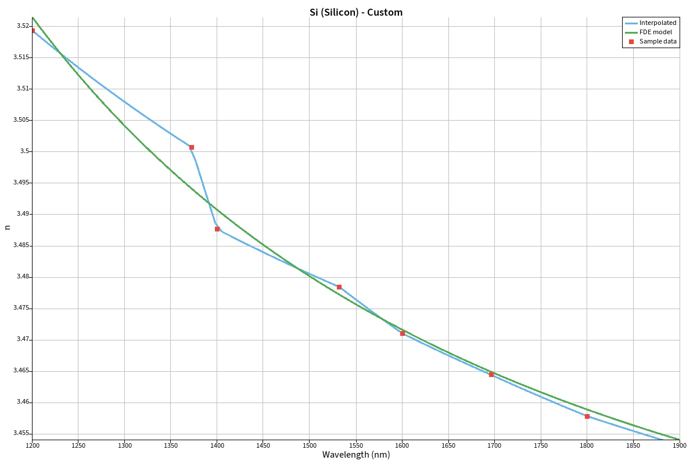
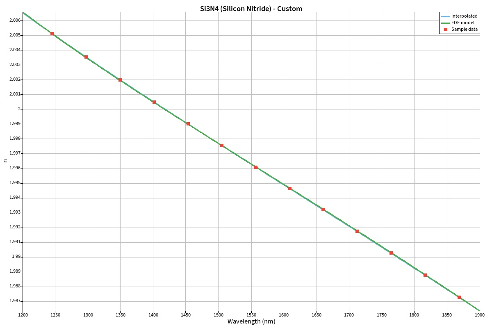
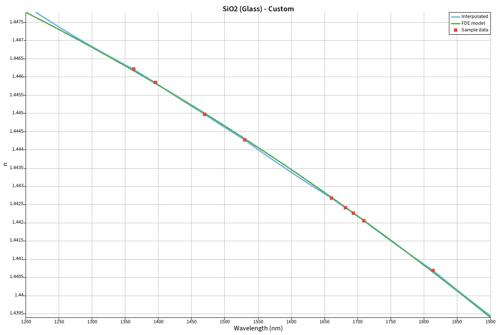

# Lumerical GUI

This example was created using the Lumerical MODE and Lumerical Scripting Language. 
It is very similiar to [this example](../gui/README.md) but in form of script.

## Results 

<table>
<tr><td width="4000">
<h3>Materials</h3>
</td></tr>
<tr><td>

1. **Si**
   * **Name:** `Si (Silicon) - Custom`
   * **Base:** `Si (Silicon) - Palik`
   * **fit tolerance:** `0.001`

 
<em>Figure 1: Silicon dispersion fitted to measurements</em>

---

2. **Si3N4**
   * **Name:** `Si3N4 (Silicon Nitride) - Custom`
   * **Base:** `Si3N4 (Silicon Nitride) - Luke`
   * **fit tolerance:** `0.001`

 
<em>Figure 1: Silicon nitride dispersion fitted to measurements</em>

---

3. **SiO2**
   * **Name:** `SiO2 (Glass) - Custom`
   * **Base:** `Si3N4 (Glass) - Palik`
   * **fit tolerance:** `0.001`

 
<em>Figure 1: Silicon dioxide dispersion fitted to measurements</em>

---

</td></tr>
</table>
