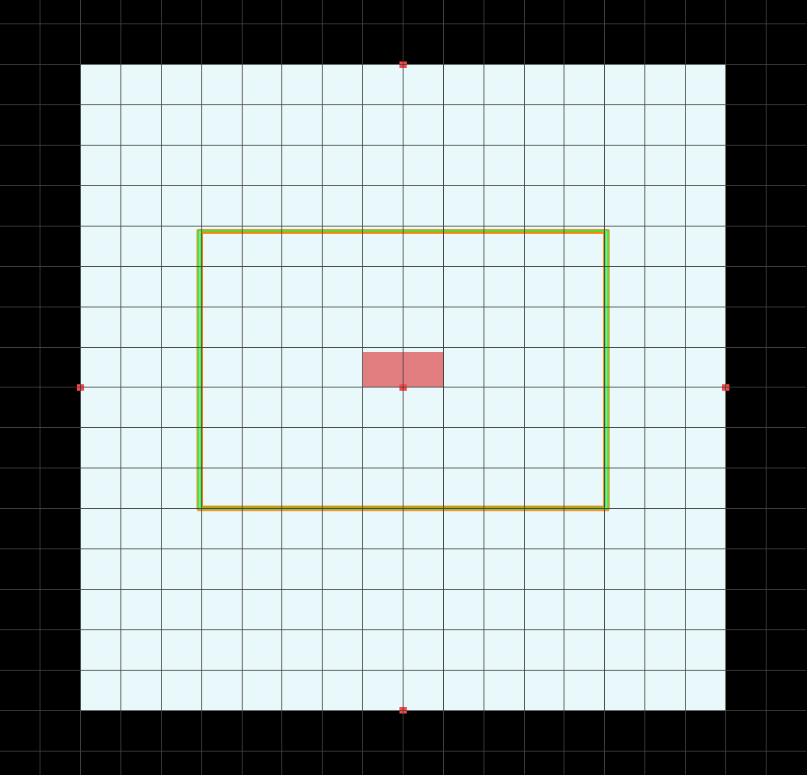
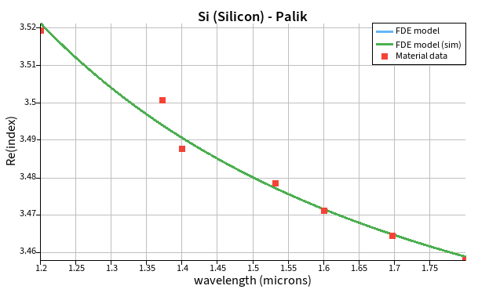
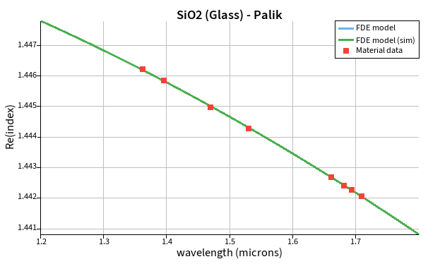

# Lumerical GUI

This example was created using the Lumerical MODE GUI and is based on 
[UBCx Phot1x](https://www.edx.org/learn/engineering/university-of-british-columbia-silicon-photonics-design-fabrication-and-data-ana) lectures.

## Steps

<table>
<tr><td width="4000">
<h3>Geometry</h3>
</td></tr>
<tr><td>

1. **Add rectangle structure**
   * **Name:** `SiO2`
   * **x (µm):** `0`
   * **x span (µm):** `4`
   * **y (µm):** `0`
   * **y span (µm):** `4`
   * **material:** `SiO2 (Glass) - Palik`
> [!NOTE]
> This step defines the geometry and material properties of the strip waveguide cladding.
---

2. **Add rectangle structure**
   * **Name:** `Si`
   * **x (µm):** `0`
   * **x span (µm):** `0.5`
   * **y min (µm):** `0`
   * **y max (µm):** `0.22`
   * **material:** `SiO2 (Glass) - Palik`
> [!NOTE]
> This step defines the geometry and material properties of the strip waveguide core.

3. **Add simulation region (Eigenmode solver)**
   * **x (µm):** `0`
   * **x span (µm):** `2.5`
   * **y (µm):** `0.11`
   * **y max (µm):** `1.7`
   * **mesh cells x:** `100`
   * **mesh cells y:** `100`
   * **boundry condition**: `Metal`
> [!NOTE]
> This step defines the simulation region. It's centered to the core of waveguide.
> It's important to set region big enough to avoid interference with boundry conditions.
---

 
<em>Figure 1: Cross-sectional view (XY, grid 0.25 µm) of the waveguide and simulation region</em>

</td></tr>
</table>

<table>
<tr><td width="4000">
<h3>Materials</h3>
</td></tr>
<tr><td>

1. **Open Material Explorer**
   * **Material:** `Si (Silicon) - Palik`
   * **fit Tolerance:** `0.1`
   * **fit with multi-coefficient model**: `✔ (checked)`
   * **wavelength min (µm):** `1.2`
   * **wavelength min (µm):** `1.8`
> [!NOTE]
> This step provide measurements-fitted function of Si dispersion.

 
<em>Figure 2: Silicon dispersion fitted to measurements</em>

---

2. **Open Material Explorer**
   * **Material:** `SiO2 (Glass) - Palik`
   * **fit Tolerance:** `0.001`
   * **fit with multi-coefficient model**: `✔ (checked)`
   * **wavelength min (µm):** `1.2`
   * **wavelength min (µm):** `1.8`
> [!NOTE]
> This step provide measurements-fitted function of SiO2 dispersion.

 
<em>Figure 3: Silicon dioxide dispersion fitted to measurements</em>

</td></tr>
</table>

<table>
<tr><td width="4000">
<h3>Materials</h3>
</td></tr>
<tr><td>

1. **Open Material Explorer**
   * **Material:** `Si (Silicon) - Palik`
   * **fit Tolerance:** `0.1`
   * **fit with multi-coefficient model**: `✔ (checked)`
   * **wavelength min (µm):** `1.2`
   * **wavelength min (µm):** `1.8`
> [!NOTE]
> This step provide measurements-fitted function of Si dispersion.

 
<em>Figure 2: Silicon dispersion fitted to measurements</em>

---

2. **Open Material Explorer**
   * **Material:** `SiO2 (Glass) - Palik`
   * **fit Tolerance:** `0.001`
   * **fit with multi-coefficient model**: `✔ (checked)`
   * **wavelength min (µm):** `1.2`
   * **wavelength min (µm):** `1.8`
> [!NOTE]
> This step provide measurements-fitted function of SiO2 dispersion.

 
<em>Figure 3: Silicon dioxide dispersion fitted to measurements</em>

</td></tr>
</table>

<table>
<tr><td width="4000">
<h3>Simlation</h3>
</td></tr>
<tr><td>

1. **Run simulation**
   * **wavelength (µm):** `1.5`
   * **Mesh the structure**
   * **Calculate Modes**

</td></tr>
</table>